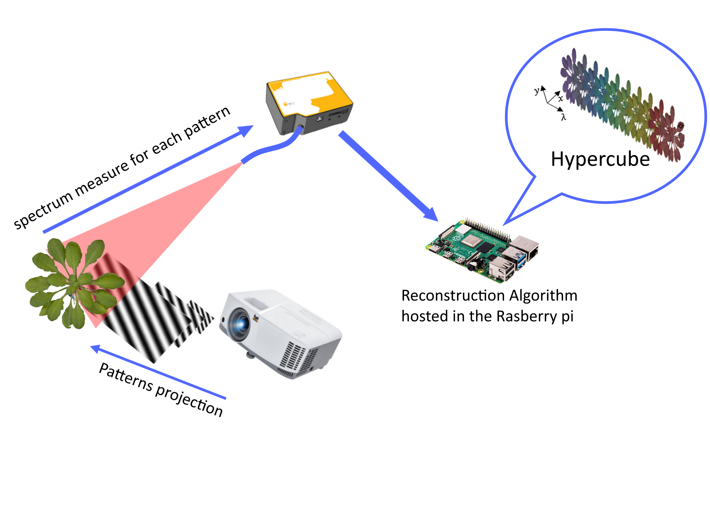

<p align="center">

</p>

# ONE-PIX

<p align="center">
Open-source modular hyperspectral single-pixel imaging ecosystem
</p>

<p align="center">
Acquisition • Reconstruction • Spectral Analysis • Plugin-Based Architecture
</p>

---

<p align="center">
<a href="https://one-pix.readthedocs.io/">Documentation</a> •
<a href="https://github.com/PhotonicsOpenProjects/ONE-PIX/wiki">Wiki</a> •
<a href="https://github.com/PhotonicsOpenProjects/ONE-PIX">GitHub</a> •
<a href="https://github.com/PhotonicsOpenProjects/ONE-PIX/issues">Issues</a>
</p>

## Introduction

The ONE-PIX project is an open-source hyperspectral camera based on single-pixel imaging principles. It enables the acquisition of hyperspectral datacubes in the visible range and can be extended toward infrared wavelengths depending on the hardware configuration.

Designed as a highly modular ecosystem, ONE-PIX supports multiple imaging methods, spectrometers, cameras and processing workflows through a plugin-based architecture. The project aims to provide an extensible platform for research, education and experimentation around computational imaging and hyperspectral acquisition.

The ONE-PIX ecosystem can be used for:

- hyperspectral imaging research
- computational imaging experiments
- rapid prototyping of custom imaging systems
- teaching and discovery of single-pixel imaging
- low-cost hyperspectral acquisition
- development of custom spectral processing pipelines

The project was originally developed to remain accessible and reproducible using affordable hardware and open-source software. It can run on Raspberry Pi devices for embedded acquisitions or on standard computers for higher performance workflows and advanced processing pipelines.

To learn more about the single-pixel imaging theory used for hyperspectral imaging, you can read our [article](https://www.ncbi.nlm.nih.gov/pmc/articles/PMC7070961/).

### Working principle

The ONE-PIX system uses a video projector and a single-pixel detector such as a spectrometer with superimposed fields of view.

<p align="center">

</p>

During acquisition, a sequence of structured light patterns is projected onto the scene. For each projected pattern, the detector measures the integrated reflected spectrum of the scene. Reconstruction algorithms then recover the spatial and spectral information from these measurements to generate a hyperspectral datacube.

The acquisition workflow is orchestrated by the ONE-PIX core framework, while imaging methods, hardware drivers and analysis pipelines can be extended independently through the modular plugin ecosystem.


## Quick Installation

### Requirements

`onepix` is compatible with Python 3.9 and 3.10.

Make sure you are using `pip >= 21.0` to install dependencies correctly.

Lower or higher versions of Python and `pip` have not been tested and are therefore not officially supported.

### Clone the repository

```bash
git clone https://github.com/PhotonicsOpenProjects/ONE-PIX.git
cd ONE-PIX
```

### Create a Python environment (recommended)

Linux / macOS:

```bash
python -m venv .venv
source .venv/bin/activate
```

Windows:

```bash
python -m venv .venv
.venv\Scripts\activate
```

### Install ONE-PIX

```bash
python install.py
```

The installation script automatically detects the current platform and installs the appropriate dependencies and hardware configuration.

On standard desktop systems (Windows/Linux/macOS), the installer deploys:

- the ONE-PIX core framework
- default imaging methods
- analysis pipeline dependencies
- scientific Python packages

On Raspberry Pi systems, the installer additionally configures the embedded acquisition environment required for hardware operation, including:

- OpenCV system dependencies
- USB and spectrometer communication
- display and projector management
- embedded acquisition configuration

For more information about Raspberry Pi hardware setup and acquisition configuration, please refer to the dedicated installation guides and wiki documentation.


## Quick Usage

### Launch the graphical interface

The easiest way to use ONE-PIX is through the Flask-based graphical interface.

From the root repository directory, launch the GUI with:

```bash
python app/GUI/flask/run.py
```

The graphical interface provides access to:

- hyperspectral acquisitions
- reconstruction workflows
- hardware configuration
- imaging method selection
- spectral analysis tools

### Run as a systemd service on Raspberry Pi

After installing all dependencies, open a terminal **in the Raspberry Pi desktop**,
activate the Python environment used to run ONE-PIX, and run from the repository root:

```bash
bash install/install_service.sh
# Or explicitly select the Python environment:
bash install/install_service.sh "$PWD/.venv/bin/python"
```

Run without `sudo`. This installs a user service in
`~/.config/systemd/user/onepix.service`, enables it for `graphical-session.target`,
and starts it immediately. Stop any manually launched ONE-PIX instance first so
port 5000 is available. The installer checks the selected Python dependencies and
display access; it does not install missing packages.

ONE-PIX needs a working graphical session for monitor detection and projection,
including X11 or XWayland (`DISPLAY`). It cannot start on a headless boot with this
configuration. Automatic startup requires a desktop that activates the systemd
user `graphical-session.target` and imports its display environment. Check with
`systemctl --user is-active graphical-session.target`. If your desktop does not
provide this integration, run the installer from a desktop terminal after login
to start the service and refresh its display environment. For unattended startup,
configure desktop automatic login and verify this integration on your Pi.
Enabling user lingering alone does not create a graphical session.

```bash
systemctl --user status onepix
journalctl --user -u onepix -f
systemctl --user restart onepix
systemctl --user stop onepix
# Disable automatic startup and stop:
systemctl --user disable --now onepix
```

The app uses its existing Flask server on port 5000 with debug disabled. This
service adds process supervision; it does not configure a production web server.

---

### Python API

Advanced users can directly interact with the ONE-PIX Python API to build custom acquisition, reconstruction and analysis workflows.

```python
from onepix.Acquisition import Acquisition
from onepix.Reconstruction import Reconstruction
from onepix.Analysis import Analysis

# Acquisition
acq = Acquisition(
    imaging_method_name="has"
)

acq.thread_acquisition()

# Reconstruction
rec = Reconstruction(
    acquisition_dict=acq.acquisition_results
)

rec.data_reconstruction()

# Analysis
ana = Analysis(
    reconstruction_dict=rec.reconstruction_results
)

ana.data_analysis()
```

More complete acquisition and analysis workflows are available in:

- `app/python_code_examples/`
- the API documentation
- the project wiki

## ONE-PIX Central Framework

The ONE-PIX repository is the central framework of the ecosystem. It provides the core orchestration layer used to manage hyperspectral acquisitions, reconstructions and analysis workflows independently from the underlying hardware or imaging methods.

The core framework is responsible for:

- acquisition workflow orchestration
- reconstruction workflow management
- analysis pipeline integration
- hardware abstraction
- imaging method management
- configuration handling
- graphical interface integration
- plugin interoperability

ONE-PIX is designed around a modular architecture where imaging methods, hardware drivers and processing pipelines can evolve independently while remaining compatible through shared interfaces and standardized data structures.

The framework can operate on both embedded acquisition systems such as Raspberry Pi devices and standard desktop environments for advanced reconstruction and spectral processing workflows.

## Ecosystem Architecture

| Component | Role |
|---|---|
| [ONE-PIX](https://github.com/PhotonicsOpenProjects/ONE-PIX) | Central framework orchestrating acquisition, reconstruction and analysis workflows |
| [onepix_plugins](https://gitlab.com/photonics-open-projects/onepix_plugins) | Main plugin ecosystem containing imaging methods, spectrometers, RGB cameras and analysis plugin families |
| [onepix_plugins_manager](https://gitlab.com/photonics-open-projects/onepix_plugins_manager) | Command-line plugin installation and ecosystem management system |
| Imaging Method Plugins | Plugins implementing acquisition, reconstruction and analysis workflows for single-pixel imaging methods |
| Spectrometer Plugins | Plugins implementing spectrometer hardware interfaces |
| RGB Camera Plugins | Plugins implementing RGB and auxiliary camera interfaces |
| pipeline-analysis | Abstract spectral processing and analysis framework |
| Analysis Plugins | Spectral processing and machine learning plugin family compatible with the analysis pipeline ecosystem |

## Core Architecture

ONE-PIX is organized around a modular workflow architecture separating:

- hyperspectral acquisition
- image reconstruction
- spectral analysis
- hardware management
- imaging method integration

This architecture allows imaging methods, hardware interfaces and analysis workflows to evolve independently while remaining interoperable inside the ONE-PIX ecosystem.

The framework supports interchangeable spectrometers, RGB cameras and single-pixel imaging strategies through a modular plugin-based ecosystem.

### Repository Architecture

```text
ONE-PIX/
├── app/
├── onepix/
├── conf/
├── install/
├── autodoc/
├── imgs/
└── logs/
```

| Directory | Role |
|---|---|
| app/ | User-facing applications including the Flask GUI, Python API examples and remote control services |
| onepix/ | Central acquisition, reconstruction and analysis framework |
| conf/ | JSON configuration files for acquisition parameters, hardware setup and calibration data |
| install/ | Platform-specific installation scripts and dependencies |
| autodoc/ | Documentation generation sources |
| imgs/ | README and documentation assets |
| logs/ | Acquisition and execution logs |

## Documentation

The ONE-PIX ecosystem documentation is primarily available through the project Wiki.

The Wiki contains detailed guides and technical documentation for:

- hardware installation
- Raspberry Pi setup
- acquisition workflows
- imaging methods
- plugin development
- spectral analysis pipelines
- calibration procedures
- remote control interfaces
- troubleshooting
- advanced API usage

### Documentation Links

- [Project Wiki](https://github.com/PhotonicsOpenProjects/ONE-PIX/wiki)
- [API Documentation](https://one-pix.readthedocs.io/)
- [Issues & Support](https://github.com/PhotonicsOpenProjects/ONE-PIX/issues)

## Contributing

ONE-PIX is an open and modular ecosystem designed for experimentation, research and community-driven development.

Contributions are welcome at multiple levels of the ecosystem, including:

- new imaging methods
- spectrometer integrations
- RGB camera integrations
- spectral analysis plugins
- processing pipelines
- hardware improvements
- documentation and tutorials
- bug fixes and performance improvements

The plugin-based architecture allows contributors to develop and distribute independent packages without modifying the central ONE-PIX framework.

For contribution guidelines, plugin development and technical discussions, please refer to the project Wiki and GitHub Issues.
