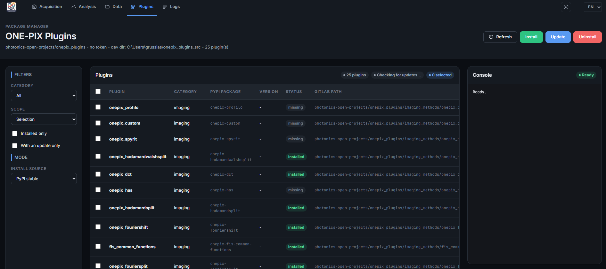
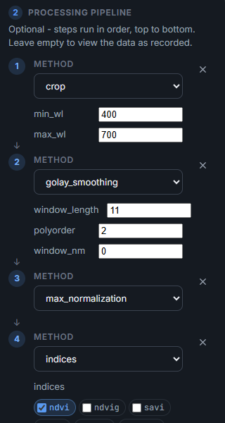
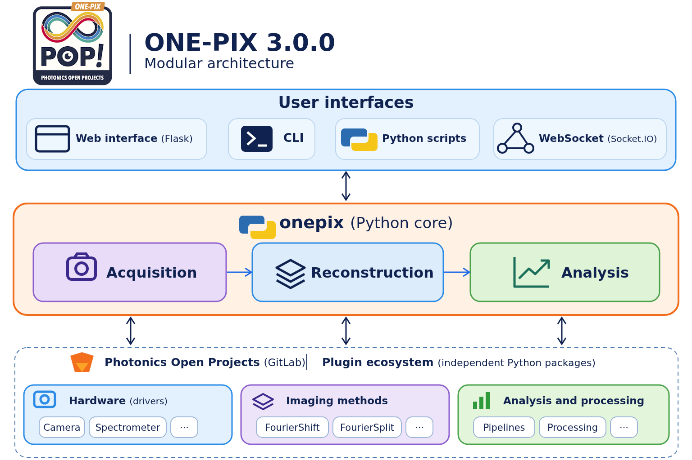

<p align="center">

</p>

# ONE-PIX

<p align="center">
Open-source modular hyperspectral single-pixel imaging ecosystem
</p>

<p align="center">
Acquisition • Reconstruction • Spectral Analysis • Plugin-Based Architecture
</p>

---

<p align="center">
<a href="https://one-pix.readthedocs.io/">Documentation</a> •
<a href="https://github.com/PhotonicsOpenProjects/ONE-PIX/wiki">Wiki</a> •
<a href="https://github.com/PhotonicsOpenProjects/ONE-PIX">GitHub</a> •
<a href="https://github.com/PhotonicsOpenProjects/ONE-PIX/issues">Issues</a>
</p>

## Introduction

The ONE-PIX project is an open-source hyperspectral camera based on single-pixel imaging principles. It enables the acquisition of hyperspectral datacubes in the visible range and can be extended toward infrared wavelengths depending on the hardware configuration.

Designed as a highly modular ecosystem, ONE-PIX supports multiple imaging methods, spectrometers, cameras and processing workflows through a plugin-based architecture. The project aims to provide an extensible platform for research, education and experimentation around computational imaging and hyperspectral acquisition.

The ONE-PIX ecosystem can be used for:

- hyperspectral imaging research
- computational imaging experiments
- rapid prototyping of custom imaging systems
- teaching and discovery of single-pixel imaging
- low-cost hyperspectral acquisition
- development of custom spectral processing pipelines

The project was originally developed to remain accessible and reproducible using affordable hardware and open-source software. It can run on Raspberry Pi devices for embedded acquisitions or on standard computers for higher performance workflows and advanced processing pipelines.

To learn more about the single-pixel imaging theory used for hyperspectral imaging, you can read our [article](https://www.ncbi.nlm.nih.gov/pmc/articles/PMC7070961/).

### Working principle

The ONE-PIX system uses a video projector and a single-pixel detector such as a spectrometer with superimposed fields of view.

<p align="center">

</p>

During acquisition, a sequence of structured light patterns is projected onto the scene. For each projected pattern, the detector measures the integrated reflected spectrum of the scene. Reconstruction algorithms then recover the spatial and spectral information from these measurements to generate a hyperspectral datacube.

The acquisition workflow is orchestrated by the ONE-PIX core framework, while imaging methods, hardware drivers and analysis pipelines can be extended independently through the modular plugin ecosystem.


## What's new in 3.0.0

*Also available in: [Français](docs/release_3.0.0/whats_new.fr.md) · [Español](docs/release_3.0.0/whats_new.es.md) · [Deutsch](docs/release_3.0.0/whats_new.de.md)*

ONE-PIX 3.0.0 is a new base for hyperspectral single-pixel imaging: a redesigned web interface, a reorganised Python core and independent plugins for imaging methods, hardware and spectral analysis. Each component can evolve without changing the whole software, while acquisition, reconstruction and analysis stay at the centre of the project.

| Area | Previous version (`main`) | ONE-PIX 3.0.0 |
|---|---|---|
| Interface | Desktop applications | Flask web interface: acquisition, analysis, data, plugins and logs |
| Core | Modules in `core/` | `onepix` package, versioned and installed with its dependencies |
| Extensions | Methods and drivers inside `plugins/` | Independent Python packages found through entry points |
| Analysis | Processing tied to each imaging method | Composable pipelines and analysis plugins |
| Results | Per-workflow save formats | Result dictionaries and JSON files with metadata |
| Installation | Historical scripts, mostly for Raspberry Pi | `install.py` for Windows, Linux and macOS, optional systemd service |

- **One interface.** Acquisition (method choice, hardware setup, progress, cancellation), settings (including panels provided by plugins), analysis, data (browse, import, download, delete), plugins and logs.
- **Plugins.** Imaging methods, spectrometer drivers, cameras and analysis pages are developed and distributed apart from this repository. A plugins manager installs, updates and removes them from the web interface. The base installation declares the FourierShift and FourierSplit methods, the common FIS components, the stub camera and spectrometer, `analysis-pipeline` and `basic-treatments`; other methods and drivers are installed separately.
- **Analysis pipelines.** Steps are chained from top to bottom (crop, smoothing, normalisation, spectral indices...), with reflectance normalisation from a reference zone or datacube. The history of applied steps is kept in the metadata, also across successive analyses. Available tools depend on the imaging method and installed plugins.
- **Better-controlled acquisitions.** Integration time in whole display frames, gray-level cap and projector response correction, pattern settling time with part of the waiting hidden in the projection sequence, averaging inside the spectrometer when the plugin allows it, live tuning with advice, and command-line probes for the projector.
- **Reusable results.** Acquisition, reconstruction and analysis exchange result dictionaries that can be saved as JSON; the examples in `app/python_code_examples/` follow this organisation, including a full acquisition, reconstruction and analysis chain.
- **Remote control and IoT.** A Socket.IO server configures and starts measurements remotely, to integrate ONE-PIX in connected applications.
- **Lighter repository.** The histories between branches were cleaned up to shrink a repository that had become too large.

<p align="center">

</p>

<p align="center"><em>The plugins manager lists extensions, filters them and installs, updates or removes them from the web interface.</em></p>

<p align="center">

</p>

<p align="center"><em>A pipeline run from top to bottom: 400-700 nm crop (<code>crop</code>), smoothing (<code>golay_smoothing</code>), normalisation (<code>max_normalization</code>), then indices (<code>indices</code>).</em></p>

Migration from the previous version: install the plugins you need, replace `core.*` by `onepix.*` in your scripts and use the web interface instead of the Tkinter applications. The full list is in [CHANGELOG.md](CHANGELOG.md).

## Quick Installation

### Requirements

ONE-PIX is installed from a clone of this repository (below): the configuration
(`conf/`) and the applications (`app/`) live next to the `onepix` package and are
not part of what `pip` builds, so `pip install onepix` alone does not give a
working installation.

`onepix` requires Python 3.9 or later. Release 3.0.0 was tested with Python 3.11 on Windows.

Make sure you are using `pip >= 21.0` to install dependencies correctly.

### Clone the repository

```bash
git clone https://github.com/PhotonicsOpenProjects/ONE-PIX.git
cd ONE-PIX
```

### Create a Python environment (recommended)

Linux / macOS:

```bash
python -m venv .venv
source .venv/bin/activate
```

Windows:

```bat
python -m venv .venv
.venv\Scripts\activate
```

In PowerShell, activate with `.venv\Scripts\Activate.ps1` instead.

### Install ONE-PIX

```bash
python install.py
```

The installation script automatically detects the current platform and installs the appropriate dependencies and hardware configuration.

On standard desktop systems (Windows/Linux/macOS), the installer deploys:

- the ONE-PIX core framework
- default imaging methods
- analysis pipeline dependencies
- scientific Python packages

On Raspberry Pi systems, the installer additionally configures the embedded acquisition environment required for hardware operation, including:

- OpenCV system dependencies
- USB and spectrometer communication
- display and projector management
- embedded acquisition configuration

For more information about Raspberry Pi hardware setup and acquisition configuration, please refer to the dedicated installation guides and wiki documentation.


## Quick Usage

### Launch the graphical interface

The easiest way to use ONE-PIX is through the Flask-based graphical interface.

From the root repository directory, launch the GUI with:

```bash
python app/GUI/flask/run.py
```

The graphical interface provides access to:

- hyperspectral acquisitions
- reconstruction workflows
- hardware configuration
- imaging method selection
- spectral analysis tools

### Run as a systemd service on Raspberry Pi

After installing dependencies, run from the repository root (also works over SSH):

```bash
bash install/install_service.sh
# Or select the Python environment explicitly:
bash install/install_service.sh "$PWD/.venv/bin/python"
```

The script requests sudo, adapts `install/onepix.service` to the current user,
repository location and selected Python, installs it in
`/etc/systemd/system/onepix.service`, enables startup at boot and restarts it.
Run as your application user, with the usual Python environment activated.
From the `install` directory, use `bash install_service.sh`.
Stop any manually launched instance first to free port 5000. A previous user
service is disabled automatically when running the installer without sudo.

```bash
sudo systemctl status onepix
sudo journalctl -u onepix -f
sudo systemctl restart onepix
sudo systemctl stop onepix
sudo systemctl disable --now onepix
```

Installation does not require DISPLAY in the terminal. The service sets
`DISPLAY=:0`; ONE-PIX still detects screens at import time, so runtime requires
an accessible graphical display. If necessary, adjust DISPLAY and XAUTHORITY
with `sudo systemctl edit onepix`, then restart the service.
The app runs its existing Flask server on port 5000 with debug disabled.


---

### Python API

Advanced users can directly interact with the ONE-PIX Python API to build custom acquisition, reconstruction and analysis workflows.

```python
from onepix.Acquisition import Acquisition
from onepix.Reconstruction import Reconstruction
from onepix.Analysis import Analysis

# Acquisition
acq = Acquisition(
    imaging_method_name="has"
)

acq.thread_acquisition()

# Reconstruction
rec = Reconstruction(
    acquisition_dict=acq.acquisition_results
)

rec.data_reconstruction()

# Analysis
ana = Analysis(
    reconstruction_dict=rec.reconstruction_results
)

ana.data_analysis()
```

More complete acquisition and analysis workflows are available in:

- `app/python_code_examples/`
- the API documentation
- the project wiki

## ONE-PIX Central Framework

The ONE-PIX repository is the central framework of the ecosystem. It provides the core orchestration layer used to manage hyperspectral acquisitions, reconstructions and analysis workflows independently from the underlying hardware or imaging methods.

The core framework is responsible for:

- acquisition workflow orchestration
- reconstruction workflow management
- analysis pipeline integration
- hardware abstraction
- imaging method management
- configuration handling
- graphical interface integration
- plugin interoperability

ONE-PIX is designed around a modular architecture where imaging methods, hardware drivers and processing pipelines can evolve independently while remaining compatible through shared interfaces and standardized data structures.

The framework can operate on both embedded acquisition systems such as Raspberry Pi devices and standard desktop environments for advanced reconstruction and spectral processing workflows.

## Security and network access

The web interface has **no sign-in** and listens on all interfaces (port 5000): anyone
who can reach it can start an acquisition, change the configuration, read and delete
measurements and install plugins. Use it on a network you trust (a private network, a
VPN such as Tailscale), not on the open internet. See [SECURITY.md](SECURITY.md).

| Variable | Role |
|---|---|
| `ONEPIX_SERVER` | `waitress` runs the web interface with waitress, a production server (`pip install "onepix[server]"`), instead of Flask's development server. Default `werkzeug`. For the service: `sudo systemctl edit onepix`, add `Environment=ONEPIX_SERVER=waitress`. |
| `ONEPIX_THREADS`, `ONEPIX_CHANNEL_TIMEOUT` | Threads (default 8) and idle-connection timeout in seconds (default 3600) of waitress. |
| `ONEPIX_COMPACT_JSON` | `0` keeps arrays as plain lists in saved JSON files instead of base64 binary (default `1`), for a program that reads them without `onepix.utils`. |
| `ONEPIX_WS_TOKEN` | Shared secret of the Socket.IO server (`app/websocket_server`), which refuses every connection without it. |
| `ONEPIX_WS_HOST` | Address the Socket.IO server listens on. Default `0.0.0.0`. |
| `ONEPIX_WS_CORS_ORIGINS` | Browser origins allowed to reach the Socket.IO server. None by default. |
| `ONEPIX_MAX_UPLOAD_MB` | Largest upload accepted by the web interface. Default `1024`. |
| `ONEPIX_TRUSTED_ORIGINS` | Extra hosts (`host[:port]`, comma separated) accepted in the `Origin` of a request, for a reverse proxy that rewrites the `Host` header. |
| `FLASK_DEBUG` | `1` enables Flask's debugger. Never on a shared network. |

## Ecosystem Architecture

| Component | Role |
|---|---|
| [ONE-PIX](https://github.com/PhotonicsOpenProjects/ONE-PIX) | Central framework orchestrating acquisition, reconstruction and analysis workflows |
| [onepix_plugins](https://gitlab.com/photonics-open-projects/onepix_plugins) | Main plugin ecosystem containing imaging methods, spectrometers, RGB cameras and analysis plugin families |
| [onepix_plugins_manager](https://gitlab.com/photonics-open-projects/onepix_plugins/onepix_plugins_manager) | Command-line plugin installation and ecosystem management system |
| Imaging Method Plugins | Plugins implementing acquisition, reconstruction and analysis workflows for single-pixel imaging methods |
| Spectrometer Plugins | Plugins implementing spectrometer hardware interfaces |
| RGB Camera Plugins | Plugins implementing RGB and auxiliary camera interfaces |
| analysis-pipeline | Abstract spectral processing and analysis framework |
| Analysis Plugins | Spectral processing and machine learning plugin family compatible with the analysis pipeline ecosystem |

## Core Architecture

ONE-PIX is organized around a modular workflow architecture separating:

- hyperspectral acquisition
- image reconstruction
- spectral analysis
- hardware management
- imaging method integration

This architecture allows imaging methods, hardware interfaces and analysis workflows to evolve independently while remaining interoperable inside the ONE-PIX ecosystem.

The framework supports interchangeable spectrometers, RGB cameras and single-pixel imaging strategies through a modular plugin-based ecosystem.

<p align="center">

</p>

<p align="center"><em>The interfaces rely on the <code>onepix</code> Python core, connected to the hardware, imaging method and analysis plugins.</em></p>

### Repository Architecture

```text
ONE-PIX/
├── app/
├── onepix/
├── conf/
├── install/
├── autodoc/
├── imgs/
└── logs/
```

| Directory | Role |
|---|---|
| app/ | User-facing applications including the Flask GUI, Python API examples and remote control services |
| onepix/ | Central acquisition, reconstruction and analysis framework |
| conf/ | JSON configuration files for acquisition parameters, hardware setup and calibration data |
| install/ | Platform-specific installation scripts and dependencies |
| autodoc/ | Documentation generation sources |
| imgs/ | README and documentation assets |
| logs/ | Acquisition and execution logs |

## Documentation

The ONE-PIX ecosystem documentation is primarily available through the project Wiki.

The Wiki contains detailed guides and technical documentation for:

- hardware installation
- Raspberry Pi setup
- acquisition workflows
- imaging methods
- plugin development
- spectral analysis pipelines
- calibration procedures
- remote control interfaces
- troubleshooting
- advanced API usage

### Documentation Links

- [Project Wiki](https://github.com/PhotonicsOpenProjects/ONE-PIX/wiki)
- [API Documentation](https://one-pix.readthedocs.io/)
- [Issues & Support](https://github.com/PhotonicsOpenProjects/ONE-PIX/issues)

## Contributing

ONE-PIX is an open and modular ecosystem designed for experimentation, research and community-driven development.

Contributions are welcome at multiple levels of the ecosystem, including:

- new imaging methods
- spectrometer integrations
- RGB camera integrations
- spectral analysis plugins
- processing pipelines
- hardware improvements
- documentation and tutorials
- bug fixes and performance improvements

The plugin-based architecture allows contributors to develop and distribute independent packages without modifying the central ONE-PIX framework.

For contribution guidelines, plugin development and technical discussions, please refer to the project Wiki and GitHub Issues
(see also [CONTRIBUTING.md](CONTRIBUTING.md)). GitHub issues are the preferred channel for questions, bugs and ideas;
write to community@photonics-open-projects.com only for private matters (security, conduct).
