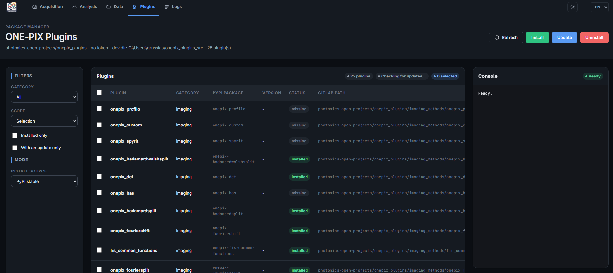
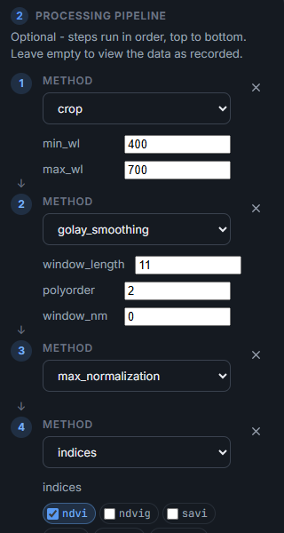
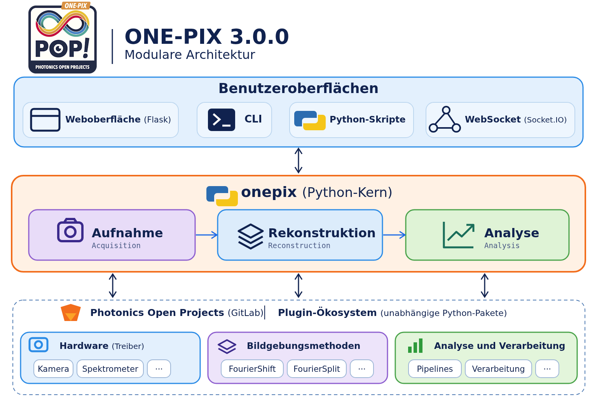

# Neu in ONE-PIX 3.0.0

[English](../../README.md#whats-new-in-300) · [Français](whats_new.fr.md) · [Español](whats_new.es.md) · **Deutsch**

ONE-PIX 3.0.0 ist eine neue Grundlage für die hyperspektrale Einzelpixel-Bildgebung: eine neu gestaltete Weboberfläche, ein neu organisierter Python-Kern und unabhängige Plugins für Bildgebungsmethoden, Hardware und Spektralanalyse. Jede Komponente kann sich weiterentwickeln, ohne die gesamte Software zu ändern; Aufnahme, Rekonstruktion und Analyse bleiben der Kern des Projekts.

| Bereich | Vorherige Version (`main`) | ONE-PIX 3.0.0 |
|---|---|---|
| Oberfläche | Desktop-Anwendungen | Flask-Weboberfläche: Aufnahme, Analyse, Daten, Plugins und Protokolle |
| Kern | Module in `core/` | Paket `onepix`, versioniert und mit seinen Abhängigkeiten installiert |
| Erweiterungen | Methoden und Treiber in `plugins/` | Unabhängige Python-Pakete, über Entry Points gefunden |
| Analyse | An jede Bildgebungsmethode gebundene Verarbeitung | Kombinierbare Pipelines und Analyse-Plugins |
| Ergebnisse | Eigene Speicherformate je Workflow | Ergebnis-Dictionaries und JSON-Dateien mit Metadaten |
| Installation | Historische Skripte, vor allem für Raspberry Pi | `install.py` für Windows, Linux und macOS, optionaler systemd-Dienst |

- **Eine Oberfläche.** Aufnahme (Methodenwahl, Hardwarekonfiguration, Fortschritt, Abbruch), Einstellungen (auch Panels, die Plugins bereitstellen), Analyse, Daten (durchsuchen, importieren, herunterladen, löschen), Plugins und Protokolle.
- **Plugins.** Bildgebungsmethoden, Spektrometertreiber, Kameras und Analyseseiten werden außerhalb dieses Repositorys entwickelt und verteilt. Ein Plugin-Manager installiert, aktualisiert und entfernt sie in der Weboberfläche. Die Basisinstallation deklariert die Methoden FourierShift und FourierSplit, die gemeinsamen FIS-Komponenten, die Simulationskamera und das Simulationsspektrometer, `analysis-pipeline` und `basic-treatments`; weitere Methoden und Treiber werden separat installiert.
- **Analyse-Pipelines.** Die Schritte werden von oben nach unten verkettet (Spektralauswahl, Glättung, Normalisierung, Spektralindizes …), mit Normalisierung auf Reflexion anhand einer Referenzzone oder eines Referenz-Hyperkubus. Der Verlauf der angewendeten Schritte bleibt in den Metadaten erhalten, auch bei aufeinanderfolgenden Analysen. Die verfügbaren Werkzeuge hängen von der Bildgebungsmethode und den installierten Plugins ab.
- **Besser kontrollierte Aufnahmen.** Integrationszeit in ganzen Anzeigebildern, Begrenzung der Graustufen und Korrektur der Projektorantwort, Einschwingzeit der Muster mit teilweiser Überlappung der Wartezeit in der Projektionssequenz, spektrometerinterne Mittelung, sofern das Plugin sie erlaubt, Live-Abstimmung mit Hinweisen sowie Kommandozeilen-Messungen am Projektor.
- **Wiederverwendbare Ergebnisse.** Aufnahme, Rekonstruktion und Analyse tauschen Ergebnis-Dictionaries aus, die als JSON gespeichert werden können; die Beispiele in `app/python_code_examples/` folgen dieser Organisation, einschließlich einer vollständigen Kette Aufnahme → Rekonstruktion → Analyse.
- **Fernsteuerung und IoT.** Ein Socket.IO-Server konfiguriert und startet Messungen aus der Ferne, um ONE-PIX in vernetzte Anwendungen einzubinden.
- **Schlankeres Repository.** Die Historien zwischen den Branches wurden bereinigt, um ein zu groß gewordenes Repository zu verkleinern.

<em>Der Plugin-Manager listet die Erweiterungen auf, filtert sie und installiert, aktualisiert oder deinstalliert sie in der Weboberfläche.</em>

<em>Von oben nach unten ausgeführte Pipeline: Auswahl 400–700 nm (<code>crop</code>), Glättung (<code>golay_smoothing</code>), Normalisierung (<code>max_normalization</code>), dann Indizes (<code>indices</code>).</em>

<em>Die Oberflächen stützen sich auf den Python-Kern <code>onepix</code>, der mit den Plugins für Hardware, Bildgebungsmethoden und Analyse verbunden ist.</em>

**Umstieg von der vorherigen Version:** Installieren Sie die benötigten Plugins, ersetzen Sie `core.*` in Ihren Skripten durch `onepix.*` und nutzen Sie die Weboberfläche statt der Tkinter-Anwendungen. Die vollständige Liste steht in [CHANGELOG.md](../../CHANGELOG.md) (auf Englisch).
