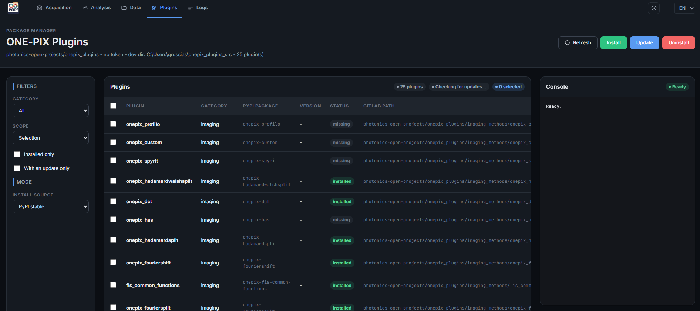
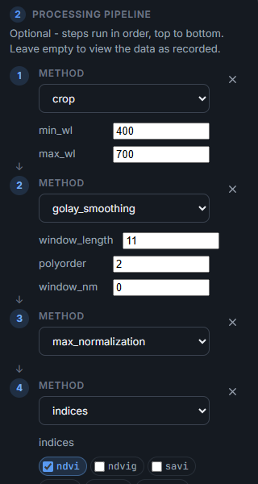
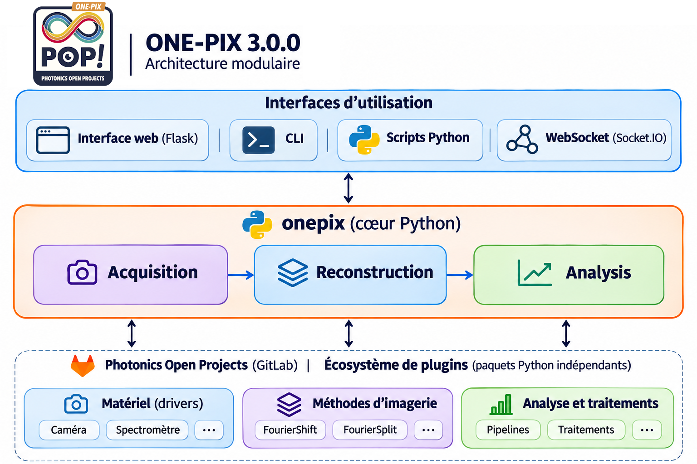

# Novedades de ONE-PIX 3.0.0

[English](../../README.md#whats-new-in-300) · [Français](whats_new.fr.md) · **Español** · [Deutsch](whats_new.de.md)

ONE-PIX 3.0.0 es una nueva base para la imagen hiperespectral de un solo píxel: una interfaz web rediseñada, un núcleo Python reorganizado y plugins independientes para los métodos de imagen, el hardware y el análisis espectral. Cada componente puede evolucionar sin modificar todo el software, y la adquisición, la reconstrucción y el análisis siguen en el centro del proyecto.

| Área | Versión anterior (`main`) | ONE-PIX 3.0.0 |
|---|---|---|
| Interfaz | Aplicaciones de escritorio | Interfaz web Flask: adquisición, análisis, datos, plugins y registros |
| Núcleo | Módulos en `core/` | Paquete `onepix`, versionado e instalado con sus dependencias |
| Extensiones | Métodos y controladores en `plugins/` | Paquetes Python independientes, descubiertos mediante puntos de entrada |
| Análisis | Procesamientos ligados a cada método de imagen | Pipelines componibles y plugins de análisis |
| Resultados | Formatos de guardado propios de cada flujo | Diccionarios de resultados y archivos JSON con metadatos |
| Instalación | Scripts históricos, sobre todo para Raspberry Pi | `install.py` para Windows, Linux y macOS, servicio systemd opcional |

- **Una sola interfaz.** Adquisición (elección del método, configuración del hardware, progreso, cancelación), ajustes (incluidos los paneles que aportan los plugins), análisis, datos (explorar, importar, descargar, eliminar), plugins y registros.
- **Plugins.** Los métodos de imagen, los controladores de espectrómetros, las cámaras y las páginas de análisis se desarrollan y distribuyen fuera de este repositorio. Un gestor de plugins los instala, actualiza y elimina desde la interfaz web. La instalación base declara los métodos FourierShift y FourierSplit, los componentes comunes FIS, la cámara y el espectrómetro de simulación, `analysis-pipeline` y `basic-treatments`; los demás métodos y controladores se instalan por separado.
- **Pipelines de análisis.** Los pasos se encadenan de arriba abajo (selección espectral, suavizado, normalización, índices espectrales…), con normalización a reflectancia a partir de una zona o de un hipercubo de referencia. El historial de los pasos se conserva en los metadatos, también en análisis sucesivos. Las herramientas disponibles dependen del método de imagen y de los plugins instalados.
- **Adquisiciones mejor controladas.** Tiempo de integración en números enteros de fotogramas de pantalla, límite de niveles de gris y corrección de la respuesta del proyector, tiempo de estabilización de los patrones con solapamiento de parte de la espera en la secuencia de proyección, promediado interno del espectrómetro cuando el plugin lo permite, ajuste en vivo con consejos y comandos de sondeo del proyector.
- **Resultados reutilizables.** La adquisición, la reconstrucción y el análisis intercambian diccionarios de resultados que se guardan en JSON; los ejemplos de `app/python_code_examples/` siguen esta organización, incluida una cadena completa adquisición → reconstrucción → análisis.
- **Control remoto e IoT.** Un servidor Socket.IO configura e inicia mediciones a distancia, para integrar ONE-PIX en aplicaciones conectadas.
- **Repositorio aligerado.** Se limpiaron los historiales entre ramas para reducir un repositorio que se había vuelto demasiado voluminoso.

<em>El gestor de plugins lista las extensiones, las filtra y las instala, actualiza o desinstala desde la interfaz web.</em>

<em>Pipeline ejecutado de arriba abajo: selección de 400–700 nm (<code>crop</code>), suavizado (<code>golay_smoothing</code>), normalización (<code>max_normalization</code>) y después índices (<code>indices</code>).</em>

<em>Las interfaces se apoyan en el núcleo Python <code>onepix</code>, conectado a los plugins de hardware, de métodos de imagen y de análisis.</em>

**Migración desde la versión anterior:** instale los plugins que necesite, sustituya `core.*` por `onepix.*` en sus scripts y use la interfaz web en lugar de las aplicaciones Tkinter. La lista completa está en [CHANGELOG.md](../../CHANGELOG.md) (en inglés).
