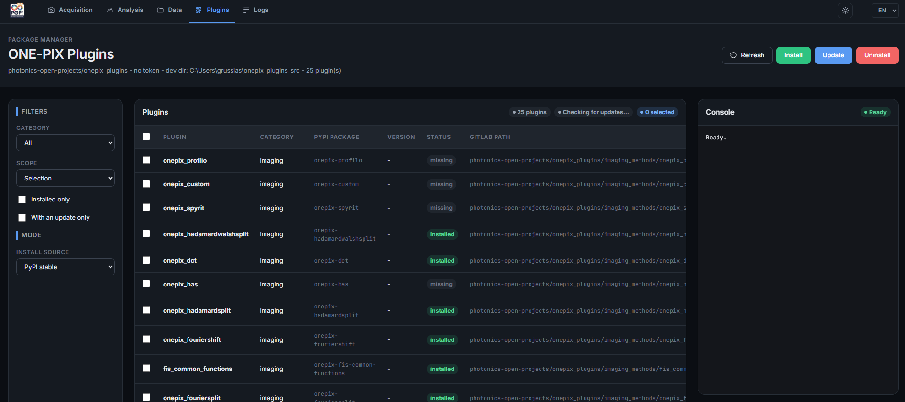
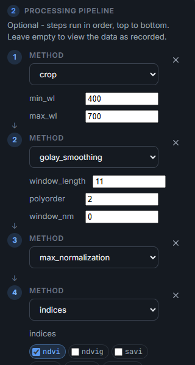
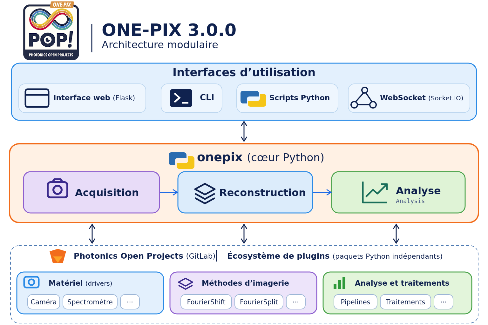

# Nouveautés de ONE-PIX 3.0.0

[English](../../README.md#whats-new-in-300) · **Français** · [Español](whats_new.es.md) · [Deutsch](whats_new.de.md)

ONE-PIX 3.0.0 est une nouvelle base pour l'imagerie hyperspectrale mono-pixel : une interface web repensée, un cœur Python réorganisé et des plugins indépendants pour les méthodes d'imagerie, le matériel et l'analyse spectrale. Chaque composant peut évoluer sans modifier tout le logiciel, tandis que l'acquisition, la reconstruction et l'analyse restent au centre du projet.

| Domaine | Version précédente (`main`) | ONE-PIX 3.0.0 |
|---|---|---|
| Interface | Applications de bureau | Interface web Flask : acquisition, analyse, données, plugins et journaux |
| Cœur | Modules dans `core/` | Paquet `onepix`, versionné et installé avec ses dépendances |
| Extensions | Méthodes et pilotes dans `plugins/` | Paquets Python indépendants, découverts via leurs points d'entrée |
| Analyse | Traitements liés à chaque méthode d'imagerie | Pipelines composables et plugins d'analyse |
| Résultats | Formats de sauvegarde propres à chaque workflow | Dictionnaires de résultats et fichiers JSON avec métadonnées |
| Installation | Scripts historiques, surtout pour Raspberry Pi | `install.py` pour Windows, Linux et macOS, service systemd optionnel |

- **Une seule interface.** Acquisition (choix de la méthode, configuration du matériel, progression, annulation), réglages (y compris les panneaux fournis par les plugins), analyse, données (parcourir, importer, télécharger, supprimer), plugins et journaux.
- **Plugins.** Méthodes d'imagerie, pilotes de spectromètres, caméras et pages d'analyse sont développés et distribués hors de ce dépôt. Un gestionnaire de plugins les installe, les met à jour et les supprime depuis l'interface web. L'installation de base déclare les méthodes FourierShift et FourierSplit, les composants communs FIS, la caméra et le spectromètre de simulation, `analysis-pipeline` et `basic-treatments` ; les autres méthodes et pilotes s'installent séparément.
- **Pipelines d'analyse.** Les étapes s'enchaînent de haut en bas (sélection spectrale, lissage, normalisation, indices spectraux…), avec normalisation en réflectance à partir d'une zone ou d'un hypercube de référence. L'historique des étapes est conservé dans les métadonnées, y compris lors d'analyses successives. Les outils disponibles dépendent de la méthode d'imagerie et des plugins installés.
- **Acquisitions mieux maîtrisées.** Temps d'intégration en nombres entiers de trames d'affichage, plafonnement des niveaux de gris et correction de la réponse du projecteur, temps de stabilisation des motifs avec recouvrement d'une partie de l'attente dans la séquence de projection, moyennage interne du spectromètre lorsque le plugin le permet, réglage en direct avec conseils, et commandes de sondage du projecteur.
- **Résultats réutilisables.** L'acquisition, la reconstruction et l'analyse échangent des dictionnaires de résultats sauvegardables en JSON ; les exemples de `app/python_code_examples/` suivent cette organisation, y compris une chaîne complète acquisition → reconstruction → analyse.
- **Pilotage à distance et IoT.** Un serveur Socket.IO configure et lance des mesures à distance, pour intégrer ONE-PIX dans des applications connectées.
- **Dépôt allégé.** Les historiques entre les branches ont été nettoyés pour alléger un dépôt devenu trop volumineux.

<em>Le gestionnaire de plugins liste les extensions, les filtre, puis les installe, les met à jour ou les désinstalle depuis l'interface web.</em>

<em>Pipeline exécuté de haut en bas : sélection de 400–700 nm (<code>crop</code>), lissage (<code>golay_smoothing</code>), normalisation (<code>max_normalization</code>), puis indices (<code>indices</code>).</em>

<em>Les interfaces s'appuient sur le cœur Python <code>onepix</code>, relié aux plugins de matériel, de méthodes d'imagerie et d'analyse.</em>

**Migration depuis la version précédente :** installez les plugins dont vous avez besoin, remplacez `core.*` par `onepix.*` dans vos scripts et utilisez l'interface web à la place des applications Tkinter. La liste complète figure dans [CHANGELOG.md](../../CHANGELOG.md) (en anglais).
